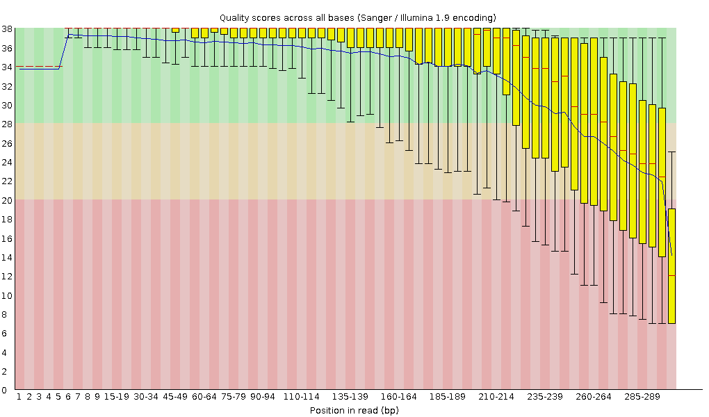
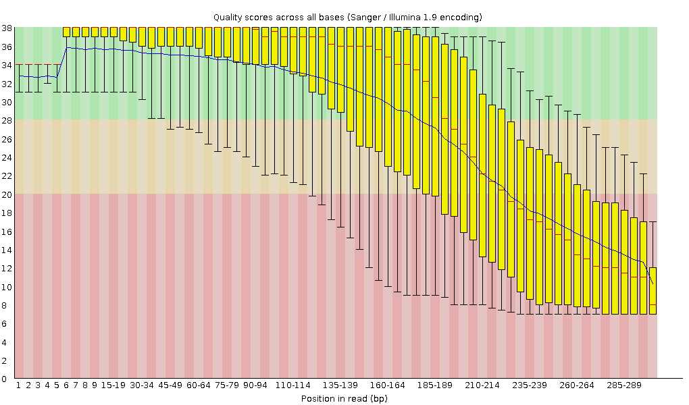
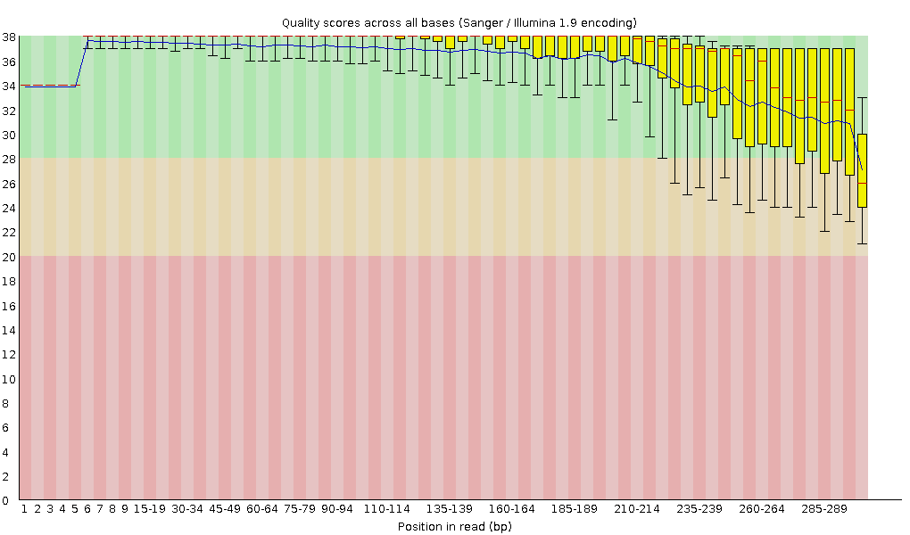
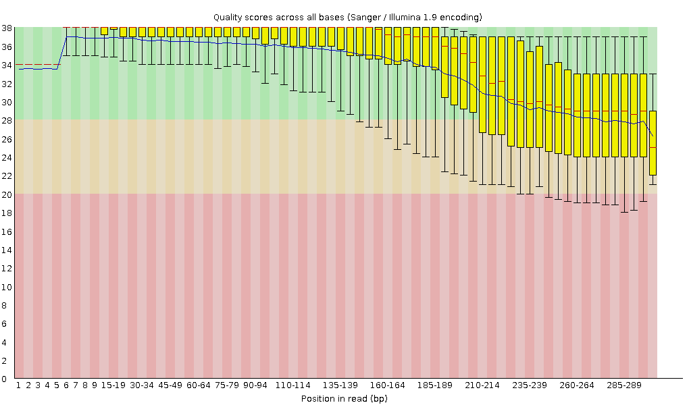
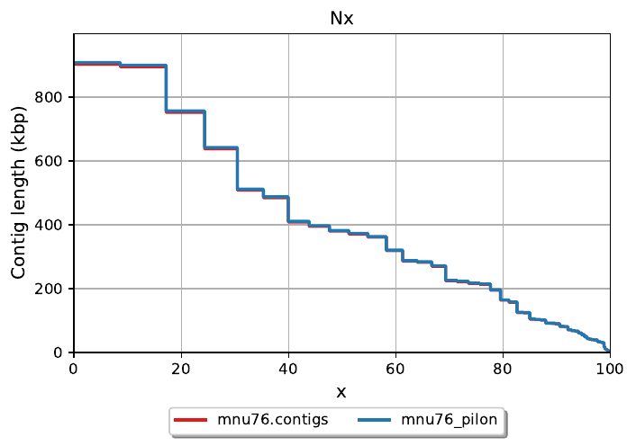
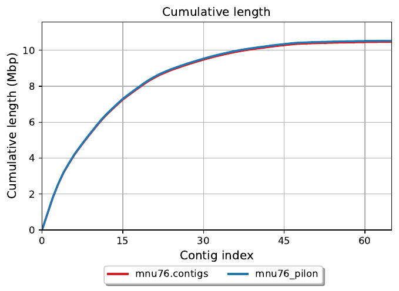
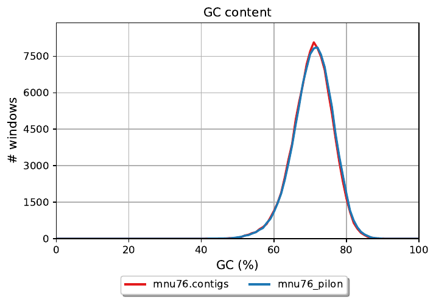
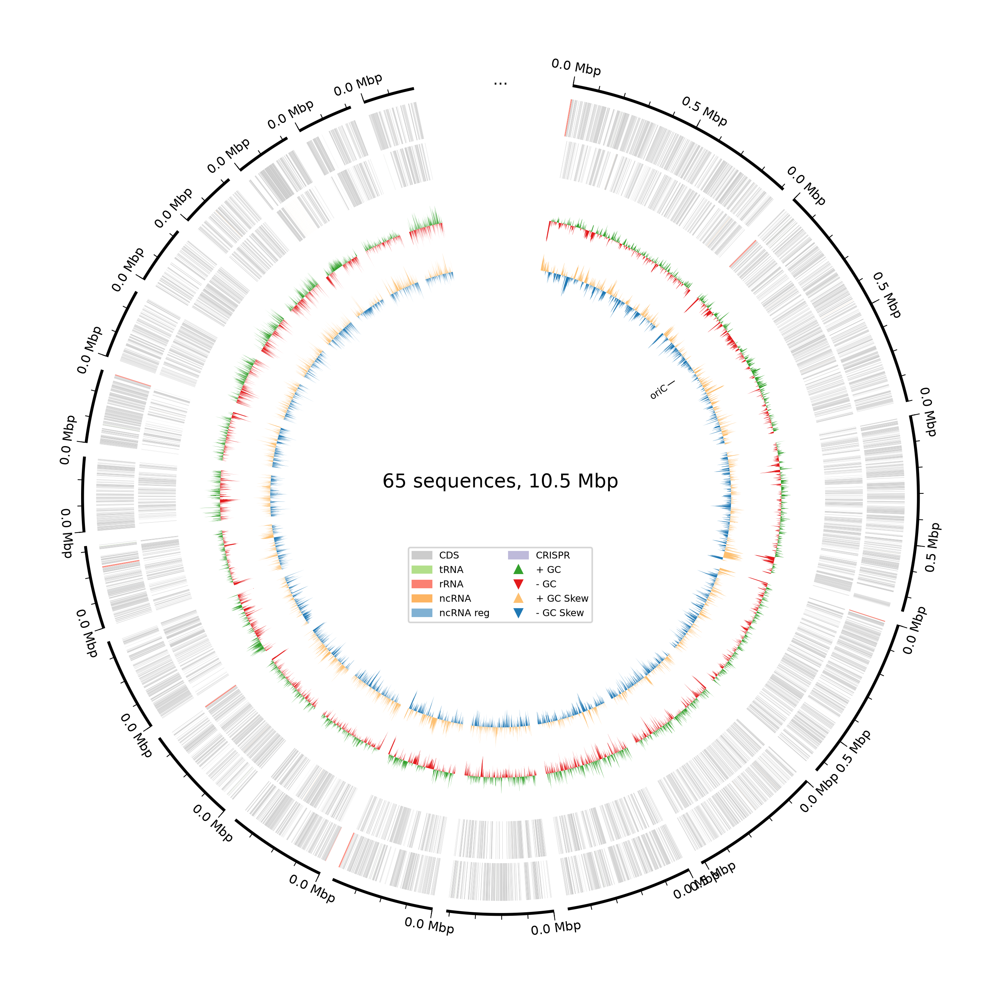

# Genome Assembly, Annotation and Biosynthetic Gene Cluster Mining of *Streptomyces* sp. MNU76

An independent computational reanalysis of publicly available Illumina and Oxford Nanopore sequencing data from *Streptomyces* sp. MNU76.

> **Project note:** The MNU76 strain and its genome have previously been reported. This repository represents an independent computational reanalysis and bioinformatics learning project and does not claim the original biological findings as novel.

## Project Overview

This project demonstrates an end-to-end microbial genome analysis workflow using short- and long-read sequencing data.

The analysis includes:

- Illumina read quality control
- Illumina read preprocessing
- Oxford Nanopore read assessment
- Long-read genome assembly
- Illumina-supported polishing
- Assembly quality assessment
- Genome annotation
- Biosynthetic gene cluster prediction

The main objective was to understand the biological and computational reasoning behind each step of microbial genome analysis.

## Dataset

The sequencing data were obtained from the NCBI Sequence Read Archive.

| Data | Accession | Platform |
|---|---|---|
| Illumina short reads | SRR8841085 | Illumina MiSeq |
| Oxford Nanopore reads | SRR8841084 | Oxford Nanopore MinION |

Raw sequencing files are not included in this repository because of their size.

## Workflow

**Public SRA data → Quality Control → Illumina trimming → Nanopore assembly → Illumina mapping → Pilon polishing → QUAST → Bakta annotation → antiSMASH genome mining**

## Tools Used

| Tool | Purpose |
|---|---|
| FastQC | Sequencing quality assessment |
| Trimmomatic | Illumina read preprocessing |
| Canu | Long-read genome assembly |
| BWA-MEM2 | Illumina read mapping |
| SAMtools | Alignment processing |
| Pilon | Assembly polishing |
| QUAST | Assembly quality assessment |
| CheckM | Genome completeness assessment |
| Bakta | Genome annotation |
| antiSMASH | Biosynthetic gene cluster prediction |

## Illumina Read QC

The raw Illumina dataset contained **8,330,624 read pairs**.

FastQC showed good overall sequencing quality with a decline toward the 3′ ends, particularly for R2.

Trimmomatic was used for quality-based trimming with:

- Sliding window: 4 bases
- Quality threshold: Q20
- Minimum length: 50 bp

After preprocessing, **7,066,880 paired reads** were retained, corresponding to approximately **84.9% paired-read retention**.

The repository contains FastQC plots comparing raw and trimmed reads.

## Oxford Nanopore Read Assessment

The Nanopore dataset contained **213,449 reads**.

| Metric | Value |
|---|---:|
| Total reads | 213,449 |
| Total bases | 322,039,984 bp |
| Mean read length | 1,508.7 bp |
| Median read length | 1,141 bp |
| Maximum read length | 21,254 bp |
| Read N50 | 2,022 bp |

Approximately **92.1% of reads had a mean read quality of at least Q10**.

An aggressive Q20 filter was therefore not applied.

## Genome Assembly

The Nanopore reads were assembled using **Canu**.

| Metric | Canu Assembly |
|---|---:|
| Contigs | 65 |
| Genome size | 10,468,810 bp |
| Largest contig | 903,465 bp |
| N50 | 380,316 bp |
| N90 | 89,936 bp |
| GC content | 70.58% |

The assembly size and high GC content were broadly consistent with the expected characteristics of the MNU76 genome.

## Illumina-Based Polishing

Illumina reads were mapped to the Canu draft assembly using **BWA-MEM2**.

The alignments were processed using SAMtools and used by **Pilon** for assembly polishing.

The polished assembly contained:

| Metric | Pilon Assembly |
|---|---:|
| Contigs | 65 |
| Genome size | 10,532,169 bp |
| Largest contig | 908,867 bp |
| N50 | 382,560 bp |
| N90 | 90,365 bp |
| GC content | 70.78% |

Polishing primarily addressed nucleotide-level differences and small insertions/deletions supported by the Illumina reads.

## Assembly Quality Assessment

**QUAST** was used to compare the draft Canu assembly with the Pilon-polished assembly.

The main metrics evaluated were:

- Total assembly length
- Number of contigs
- Largest contig
- N50
- N90
- L50
- L90
- GC content

The polished assembly showed a small improvement in N50 and assembly length while retaining the same number of contigs.

## Genome Annotation

The polished assembly was annotated using **Bakta**.

Bakta predicted:

| Feature | Number |
|---|---:|
| CDS | 9,777 |
| tRNA | 84 |
| rRNA | 27 |
| ncRNA | 39 |
| tmRNA | 1 |
| CRISPR arrays | 0 |

Additional genome characteristics:

- Genome size: 10,532,169 bp
- GC content: 70.8%
- N50: 382,560 bp
- Coding density: 84.9%

Approximately 3,124 predicted CDS features were classified as hypothetical proteins.

> CDS predictions are computational predictions and should not automatically be interpreted as experimentally confirmed genes.

## Biosynthetic Gene Cluster Mining

The polished genome was analysed using **antiSMASH 8.0.4**.

antiSMASH identified **42 predicted secondary-metabolite regions**.

The predicted regions included:

- Polyketide synthases (PKS)
- Non-ribosomal peptide synthetases (NRPS)
- NRPS-like systems
- Terpenes
- RiPPs
- Siderophore-related pathways
- Ectoine
- Other secondary-metabolite-associated regions

These results indicate substantial biosynthetic potential within the genome.

However, a predicted biosynthetic gene cluster does not demonstrate that a compound is produced or biologically active. Experimental validation would be required.

## Key Results

| Analysis | Result |
|---|---:|
| Illumina read pairs | 8,330,624 |
| Paired reads after trimming | 7,066,880 |
| Paired-read retention | ~84.9% |
| Nanopore reads | 213,449 |
| Nanopore total bases | ~322 Mb |
| Canu contigs | 65 |
| Canu assembly size | 10.47 Mb |
| Canu N50 | 380 kb |
| Pilon assembly size | 10.53 Mb |
| Pilon N50 | 383 kb |
| Pilon GC | 70.78% |
| Bakta CDS predictions | 9,777 |
| antiSMASH predicted regions | 42 |

## Figures and Interpretation

### 1. Illumina Read Quality Control

The following FastQC plots show per-base Phred quality scores for the Illumina dataset (`SRR8841085`), before and after Trimmomatic preprocessing. R1 and R2 represent the first and second reads of each paired-end fragment.

#### Raw R1 — Before trimming

**Interpretation:** The plot shows the distribution of base quality scores across raw R1 reads. Quality decreases toward the 3′ end, indicating lower confidence in bases near the read ends.

#### Raw R2 — Before trimming

**Interpretation:** Raw R2 shows stronger 3′-end quality degradation than R1. This supported quality-based trimming before downstream analysis.

#### Trimmed R1 — After Trimmomatic

**Interpretation:** This plot shows R1 quality after Trimmomatic preprocessing. Low-quality terminal regions were reduced while retaining reads suitable for downstream mapping and polishing.

#### Trimmed R2 — After Trimmomatic

**Interpretation:** This plot shows R2 quality after trimming. Read retention was evaluated alongside quality: 7,066,880 paired reads remained from 8,330,624 original pairs, giving approximately 84.9% paired-read retention.

### 2. Genome Assembly Quality Assessment

QUAST was used to compare the Canu draft assembly with the Pilon-polished assembly. The assembly contained 65 contigs before and after polishing.

#### Nx plot

**What it shows:** Contig length thresholds across cumulative assembly-length fractions. N50 is the contig length at which contigs of that length or longer account for at least 50% of the total assembly length.

**Result:** N50 increased from 380,316 bp in the Canu assembly to 382,560 bp after Pilon polishing.

#### Cumulative assembly plot

**What it shows:** The cumulative length of contigs as they are added in descending order of length. It helps visualize how assembly length is distributed among contigs.

#### GC content comparison

**What it shows:** GC-content distributions for the Canu draft and Pilon-polished assemblies.

**Result:** The overall GC content reported by QUAST was 70.58% for Canu and 70.78% for Pilon.

### 3. Genome Annotation

#### Bakta genome map

**What it shows:** A visualization of genomic features predicted by Bakta across the assembled contigs.

**Result:** Bakta predicted 9,777 coding-sequence (CDS) features, 84 tRNAs, 27 rRNAs, 39 ncRNAs and 1 tmRNA. These are computational annotations and should not be treated as experimentally confirmed features.

### Figure Interpretation Summary

| Figure | Dataset or output | Main purpose |
|---|---|---|
| `01_raw_R1_quality.png` | Raw Illumina R1 | Assess initial base quality |
| `02_raw_R2_quality.png` | Raw Illumina R2 | Assess initial base quality |
| `03_trimmed_R1_quality.png` | Trimmed Illumina R1 | Evaluate post-trimming quality |
| `04_trimmed_R2_quality.png` | Trimmed Illumina R2 | Evaluate post-trimming quality |
| `08_assembly_Nx_plot.png` | QUAST | Assess contig-length distribution |
| `09_assembly_cumulative_plot.png` | QUAST | Assess cumulative assembly length |
| `10_assembly_GC_comparison.png` | QUAST | Compare assembly GC content |
| `07_bakta_genome_map.png` | Bakta | Visualize predicted genomic features |
## Limitations

- This is an independent computational reanalysis of publicly available sequencing data.
- The assembly generated here was less contiguous than the previously reported assembly.
- CheckM marker identification and alignment were completed, but the final pplacer step was terminated because of computational resource limitations. Therefore, a final CheckM completeness or contamination value is not reported.
- Different annotation tools and databases can produce different numbers of predicted coding sequences.
- antiSMASH results represent computational predictions and require experimental validation.

## Reproducibility

The analysis was performed using Linux/WSL and Conda-based bioinformatics environments.

Commands, workflow notes and selected outputs will be provided in the repository.

Raw sequencing data can be retrieved from the NCBI SRA using:

- SRR8841085
- SRR8841084

## What I Learned

This project provided practical experience with an end-to-end microbial genome analysis workflow:

**Raw sequencing data → QC → preprocessing → long-read assembly → short-read polishing → assembly assessment → annotation → genome mining**

It also demonstrated the complementary strengths of sequencing technologies:

- **Illumina:** high per-base accuracy
- **Oxford Nanopore:** longer reads that support genome assembly
- **Combined approach:** long reads provide assembly continuity while Illumina reads support polishing

## Acknowledgement

The publicly available MNU76 sequencing dataset and the original research study provided the basis for this independent computational reanalysis.

This repository is intended as a bioinformatics learning, reproducibility and portfolio project and does not claim ownership of the original biological discoveries.
